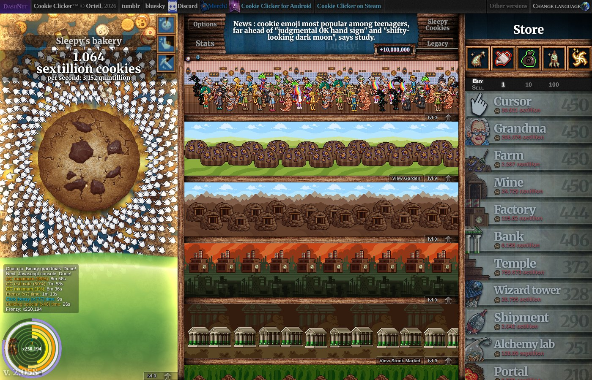

<p align="center"></p>

# Sleepy Cookies

**Sleepy Cookies plays Cookie Clicker for you.** It clicks, buys, casts spells, picks gods, trades stocks, tends the garden and works through your missing achievements, all with the game's own numbers rather than guesswork.

It's an add-on (a mod) for [Cookie Clicker](https://orteil.dashnet.org/cookieclicker/) **v2.058**, on the web or on Steam. It started as a rebuild of [Frozen Cookies](https://github.com/erbkaiser/FrozenCookies), the classic automation mod, fixed for the current game. On top of that it adds:

- **Smart Grimoire:** reads the upcoming Force the Hand of Fate results and casts at the best moment, including double casts and combo chaining.
- **Auto Pantheon:** tests every combination of gods and slots the best one.
- **Stock market trader:** simulates each stock's future with the game's own market rules before buying or selling.
- **Garden planter:** unlocks new seeds as fast as possible, or farms the most profitable plant.
- **Achievement goals:** lists every achievement you're missing with a time estimate and works on them for you.
- **Lucky 7s ascending:** gets the Lucky digit, Lucky number and Lucky payout heavenly upgrades.

It's a single file with no dependencies.

| A combo in progress (Frenzy + Click Frenzy + Building Special) | The Sleepy Cookies menu |
| --- | --- |
|  |  |

> **Heads-up:** this is automation. It plays the game for you, which some players consider cheating. Use it if that's how you enjoy the game. It never touches anything outside Cookie Clicker, and nothing it does is sent anywhere.

## Contents
- [Install](#install)
- [First steps](#first-steps)
- [What it does](#what-it-does)
- [Good to know](#good-to-know)
- [Keyboard shortcuts](#keyboard-shortcuts) · [Console commands](#console-commands) · [Troubleshooting](#troubleshooting)
- [Credits and license](#credits-and-license)

## Install

Pick **one** of these three.

### 1. Userscript (web version, recommended)
Loads automatically every time you open the game.

1. Install a userscript manager: [Tampermonkey](https://www.tampermonkey.net/) or [Violentmonkey](https://violentmonkey.github.io/).
2. Open **[sleepy-cookies.user.js](https://sleeeeeeeeeeeeeep-cmyl.github.io/sleepy-cookies/sleepy-cookies.user.js)** and click **Install**.
3. Open Cookie Clicker at `orteil.dashnet.org/cookieclicker/`.

The userscript itself is only a loader: each time, it fetches the latest Sleepy Cookies from this site, so you get updates without reinstalling, usually within the hour.

### 2. Steam version

1. Download **[SleepyCookies-steam.zip](https://sleeeeeeeeeeeeeep-cmyl.github.io/sleepy-cookies/SleepyCookies-steam.zip)**.
2. In Steam, right-click Cookie Clicker → **Manage → Browse local files**, then open `resources\app\mods\local`.
3. Unzip the download there, so you end up with `mods\local\SleepyCookies\info.txt` (plus `main.js` and `thumbnail.png`).
4. Start the game, open **Options → Manage mods**, turn on **Sleepy Cookies**, and restart the game if it asks.

Like the userscript, the mod folder fetches the latest version from this site at startup, so **it needs an internet connection** when the game starts. Steam achievements keep working while it's on.

### 3. Console or bookmark (web version, one time)
Good for trying it out. It's gone when you reload the page.

Open Cookie Clicker, press **F12 → Console**, paste this and press Enter:

```js
Game.LoadMod('https://sleeeeeeeeeeeeeep-cmyl.github.io/sleepy-cookies/sleepy_cookies.js');
```

Or save this as a bookmark and click it while the game is open:

```
javascript:(function(){Game.LoadMod('https://sleeeeeeeeeeeeeep-cmyl.github.io/sleepy-cookies/sleepy_cookies.js');})();
```

The console prints `undefined` afterwards. That's normal.

## First steps

1. **Back up your save first:** Options → **Export save**, and keep the text somewhere safe. Sleepy Cookies spends cookies, sugar lumps and garden seeds, and some options ascend for you.
2. Click the **Sleepy Cookies** button at the top of the middle panel, where the game's Info button was. The game's Info is now inside this menu.
3. Scroll to the bottom and click **Apply recommended settings**. That turns on the everyday features and switches auto-ascend off. It leaves the stock trader, garden planter and achievement goals as they are, and those start **off** until you turn them on.
4. Hover over any button in the menu to see what it does.

Settings are saved in your browser (or in the Steam game), so they're still there next time. Clearing your browser's site data resets them.

## What it does

### Clicking
- Clicks the big cookie up to 50 times a second (the most the game accepts from a script), and can switch to a different speed during click frenzies.
- Clicks golden cookies, wrath cookies and reindeer. If a Force the Hand of Fate backfire made a golden cookie that would give a Clot or Ruin, it's left alone to fade.
- Clicks fortunes in the news ticker.

### Buying
- **What to buy:** whichever building or upgrade gives the most CpS for its price, using Frozen Cookies' efficiency formula. That formula also counts golden cookies, clicking, wrinklers and reindeer.
- **While saving up:** if the best pick isn't affordable yet, it still buys cheaper upgrades that pay for themselves before the pick would be affordable anyway. You reach it at the same time or sooner, with more CpS.
- **Right after ascending:** when everything costs almost nothing next to your cookies, it buys every upgrade and building under 0.1% of your spare cookies in one go, instead of one at a time.
- **Upgrade chains:** works out what an upgrade needs to unlock (buildings, other upgrades, Santa levels) and buys towards it.
- **Everything else it buys:** Santa levels, reward cookies, eggs, dragon drops and other useful upgrades the formula can't put a number on. It also switches seasons to collect seasonal upgrades and can stay in a free season.
- **Cookie bank:** it keeps a stock of cookies so Lucky golden cookies pay out in full, and **no purchase ever dips into it**. That's why it sometimes waits with cookies on hand (see [Good to know](#good-to-know)). You can add:
  - a manual bank (minutes of CpS to keep)
  - a Spontaneous Edifice bank
  - a garden harvest bank
- **Blacklists** for challenges: Speedrun, Hardcore, Grandmapocalypse and No buildings. The first three turn themselves off once their goal is reached; No buildings stays on until you change it.
- **Building limits:** caps on mines and factories (keeps Godzamok cheap), wizard towers (by max mana) and Yous.

### Other automation
- **Wrinklers:** pops them efficiently (only when that gets the next purchase sooner) or instantly. Shiny wrinklers can be protected.
- **Sugar lumps:**
  - harvests ripe lumps
  - can slot Rigidel for the harvest
  - can swap in Dragon's Curve (and Reality Bending) at harvest time
  - never goes below the number of lumps you choose to keep (100 keeps the full Sugar baking bonus)
- **Golden switch and Godzamok:** during click buffs, turns on the Golden switch and sells and rebuys mines and factories for Godzamok, but only when the extra clicking is worth more than the cost. A Golden switch you turned on yourself is left alone.
- **Sugar Frenzy:** buys it (once per ascension, 1 sugar lump) the first time your CpS multiplier reaches your chosen level.
- **Bank office:** upgrades the office, hires brokers and takes loans during big boosts.

### Ascending
Off by default. When it ascends, it waits 10 seconds on the Ascend screen and then reincarnates. **It doesn't spend your heavenly chips for you**: use those 10 seconds, or leave the chips for later.
- **At a set number of heavenly chips**, or **when your prestige would double.** Before ascending it cashes in wrinklers, stocks, the garden and the Chocolate egg (opened in time to count towards your chips).
- **Lucky 7s:** Lucky digit, Lucky number and Lucky payout only appear in the shop when your prestige level contains one, two and four 7s. This mode ascends the moment your new prestige level would have the 7s the next one needs, and buys it. It skips the cash-in so the number doesn't change on the way.
- **Ascend during combos:** off by default, so it waits for a big boost to end before ascending.

### Smart Grimoire
The game decides each Force the Hand of Fate result in advance, so Sleepy Cookies reads the next ones and plans each cast:
- **Free sugar lump next:** cast immediately.
- **Good result next** (Click Frenzy, Elder Frenzy, Building Special, Cursed Finger or Lucky):
  - casts the moment your CpS multiplier reaches your **minimum boost** (default ×7, so any Frenzy counts)
  - needs only enough mana for the spell, not a full bar
  - won't stack a second Click Frenzy on top of one that's still running
- **Two good results in a row with full mana:** double-casts. It sells wizard towers so the second cast is cheap, checks the prediction again, then buys the towers back. That needs about 81 max mana, which the recommended settings aim for.
- **Bad result next** (Clot, Ruin, Blab, a Cookie Storm drop): uses a cheap spell to get past it, so the next cast is a good one. During a Clot it uses Stretch Time when that spell is predicted to backfire, because a backfire shortens the Clot.
- **Combo chaining**, while a boost stack is running:
  - **A bad result with a good one right behind it:** if there's mana for both, it skips the bad one and casts the good one a second later. When Stretch Time is predicted to succeed, it uses that for the skip, which also makes every running buff 10% longer.
  - **A click buff on top of a Frenzy:** uses Stretch Time to lengthen the whole stack, but only when it will succeed and enough mana is left for the next Force the Hand of Fate.
- **Spell tooltip:** hover over Force the Hand of Fate to see the next four results.

### Auto Pantheon
Tests every combination of the useful gods with the efficiency formula and slots the best one, including leaving a slot empty when a god would cost more than it gives.
- It only spends a worship swap when the gain is over 1%.
- Godzamok stays in the diamond slot while Auto Godzamok is on.
- Rigidel is left to the sugar lump option.

### Dragon
Trains and pets the dragon (for its drops), sets your two chosen auras, and can sell Yous for Dragon Orbs. The dragon window only stays open if you opened it yourself.

### Stock market trader (Sleepy extra)
Off by default.
- **How it decides:** every market tick (once a minute), it simulates 120 possible next 4 hours for each stock using the game's own price rules. By default it also uses each stock's hidden trend, which the game keeps but doesn't show.
- **Buying:** when the expected profit after the broker fee is at least your minimum (15% by default).
- **Selling:** when the current price beats what holding on is expected to bring.
- **Money:**
  - It never touches the cookie bank.
  - It only uses cookies auto-buy is saving up when a stock is expected to grow faster than the next purchase would pay back. That's usually late game, when purchases take days to pay off.

### Garden planter (Sleepy extra)
Off by default.
- **Unlock new seeds:**
  - **Target:** picks the locked seed that should unlock soonest, counting the time to grow the parents, the wait for the mutation and the time for the new plant to grow.
  - **Odds:** works out the exact chance of each mutation from the game's own rules, including that a 20% Baker's wheat spread competes with a 5% Thumbcorn for the same tile.
  - **Layout:** improves the planting layout tile by tile. For Thumbcorn on a full plot that means 26 mutation spots instead of 8.
  - **Spores:** for Brown mold and Crumbspore it grows Meddleweed and removes it just before it would die of old age, because older weeds drop spores more often.
  - **Harvest:** picks each new plant once it's mature, which unlocks its seed.
- **Farm one seed:** set to **Auto**, it picks the seed and soil worth the most cookies per second right now.
  - It tests each option by filling the plot with that plant in a simulation and recalculating your CpS, including golden cookie, milk and clicking effects.
  - It counts harvest payouts too, for example Bakeberry pays 3% of your bank, up to 30 minutes of CpS.
  - It harvests payout plants (Bakeberry, Chocoroot, Queenbeet, Duketater) when they're mature and leaves passive ones like Baker's wheat to live out their life.
- **Soil:** changes automatically. When unlocking, parents grow on Fertilizer, it switches to Wood chips (3× mutations) once they're mature, and goes back to Fertilizer while a new plant grows. When farming, it uses whichever soil pays best.
- **Weeds:** clears weeds and unwanted mutations.

### Achievement goals (Sleepy extra)
Off by default. The menu lists every achievement you're missing, read live from your game, quickest first. Each entry shows an estimate of how long it will take and what it still needs (for example "1,896 of 7,777 golden cookies clicked"), using the same checks the game itself uses. Achievements you unlock drop off the list by themselves.

Choose how it works on them:
- **Fastest first:** every missing achievement it can work on, quickest first.
- **My list:** only the ones you tick in the list.
- **Off.**

Labels in the list:
- **▶** — being worked on right now.
- **(you)** — needs you, for example Wrinkler poker or Baby it's old outside.
- **(passive)** — comes with normal play, for example Black cat's paw.
- **(no helper)** — shown so you know it's there, but the add-on can't do it (seasonal events, Santa and dragon levels).
- **⚠️** — a risky goal (see below).

When two goals clash, the quickest one wins. Reincarnation wants many short runs while Liquid assets wants one long one, for example.

What it does for each goal:
- **Building counts** (50 farms, 100 of every building and so on): buys them in one go once your spare cookies cover it.
- **Building level 10 and Pyramid scheme (Cursor level 12):** spends sugar lumps above your "lumps to keep" on the quickest one.
- **Reincarnation (and other ascension counts):** starting from your next Ascend screen (with 30 seconds to spend chips the first time), it reincarnates and ascends again as soon as the next ascension would count, until it reaches 100. **The game only counts an ascension that raises your prestige level**, so at a very high prestige level each one still needs a big run.
- **Debt evasion:** takes Loan 1 right before ascending. Your bank office needs level 2 in that run.
- **A wizard is you:** casts the cheapest spell whenever the mana bar is full and no good Force the Hand of Fate result is waiting.
- **Reindeer sleigher:** switches to Christmas and stays there.
- **Buy buy buy, Rookie numbers, No nobility in poverty:** stock purchases from spare cookies, never the bank.
- **Keeper of the conservatory / Green, aching thumb:** sets the garden planter to unlock seeds, or to grow and harvest the fastest-maturing seed.
- **Liquid assets, And a little extra (and Pyramid scheme):** pause auto-ascend so the run keeps going.
- **Risky goals:** Fastest first only uses these with **Risky Goals** on. Ticking one yourself counts as a yes.
  - **Hand-picked:** harvests a sugar lump once it's mature but before it's ripe. That's a 50% chance of getting the lump; otherwise it's lost.
  - **Seedless to nay:** sacrifices the garden once all 34 seeds are unlocked. You get 10 sugar lumps, and your seeds reset.
  - **Neverclick and Hardcore:** these only count in a **Born again** run (or before your first ascension ever). It picks Born again on your next Ascend screen, clicks at most 15 times, and buys no upgrades until both are yours, then ascends back to a normal run. While Hardcore is the goal, **no upgrade can be bought at all, even by hand**, so one stray click can't ruin the run. A Born again run takes about 3 hours to reach 1 billion cookies.

### Info and display
- An info section with everything Frozen Cookies shows: next purchase, bank, golden cookie timers, heavenly chip rate, frenzy times and stat graphs.
- An optional timer wheel.
- Five number formats.
- Adjustable frame rate.

## Good to know
- **"It has cookies but isn't buying."** It's usually refilling the cookie bank, which keeps Lucky golden cookies paying out in full. Type `SleepyCookies.nextPurchase()` in the console to see what it's saving for. If it never buys anything, check that **AutoBuy** is on (the `a` key toggles it) and that **Blacklist** is OFF.
- **Keep the game visible.** Browsers slow down background tabs and minimized windows, so the add-on (and golden cookie clicking) slows down too. The game keeps producing, but the add-on can't act on it. Give the game its own window if you want to do other things. The Steam version doesn't have this problem.
- **It only runs while the game is open.** Offline progress is the game's own, without any automation.
- **Auto-ascend doesn't spend heavenly chips.** It gives you 10 seconds on the Ascend screen, then reincarnates. The only exception is Lucky 7s mode, which buys the Lucky upgrade it ascended for.
- **Your save isn't changed by loading it.** Only what the add-on does while running changes your game, and `SleepyCookies.stop()` switches it off and puts the game back to normal.
- **Built for v2.058.** Other versions of the game, or other copies of it on other sites, may not work.

## Keyboard shortcuts
These don't work while you're typing in a text box.

| Key | Action |
| --- | --- |
| `a` | Auto-buy on/off |
| `b` | Copy your building counts |
| `c` | Auto-click golden cookies on/off |
| `e` | Export your save |
| `r` | Open the Ascend prompt |
| `s` | Save the game |
| `w` | Show the wrinkler payout, with a button to pop them all |

## Console commands
Press **F12 → Console** in the game to use these.

| Command | What it does |
| --- | --- |
| `SleepyCookies.version` | Which version is loaded |
| `SleepyCookies.nextPurchase()` | What auto-buy will get next |
| `SleepyCookies.nextSpell(0)` | The next Force the Hand of Fate result (`1` = the one after, and so on) |
| `SleepyCookies.stop()` | Switch the add-on off and restore the game |
| `SleepyCookies.resetSettings()` | Put every setting back to its default (load the add-on again afterwards) |

## Troubleshooting
- **No Sleepy Cookies button:**
  - With the console or bookmark, check the link: the file is `sleepy_cookies.js`, with an underscore.
  - With the userscript, make sure it's enabled in Tampermonkey/Violentmonkey and that you're on `orteil.dashnet.org/cookieclicker/`.
  - With Steam, make sure the mod is ticked in **Options → Manage mods** and that you were online when the game started.
- **Still the old version after an update:** GitHub Pages can take a few minutes to publish a change, and the userscript can keep the old copy for up to an hour. Reload with **Ctrl+F5**, then check `SleepyCookies.version`.
- **The console line does nothing on Steam:** that's expected. The console and bookmark only work in the web version; use install option 2.
- **Something went wrong:** `SleepyCookies.stop()` switches everything off at once. Then please [open an issue](https://github.com/sleeeeeeeeeeeeeep-cmyl/sleepy-cookies/issues) saying what happened and which version you're on.

## Credits and license

Based on [Frozen Cookies](https://github.com/Icehawk78/FrozenCookies) by Icehawk78, erbkaiser and contributors. Cookie Clicker is made by Orteil and Opti ([DashNet](https://orteil.dashnet.org/)); Sleepy Cookies is a fan-made add-on and isn't affiliated with them.

Frozen Cookies is released under **GPL-3.0-or-later**, so Sleepy Cookies is too. You can use, change and share it, but anything you distribute that's based on it has to keep the same license and make its source available. See [LICENSE](LICENSE).

Bug reports and ideas are welcome in [Issues](https://github.com/sleeeeeeeeeeeeeep-cmyl/sleepy-cookies/issues).
