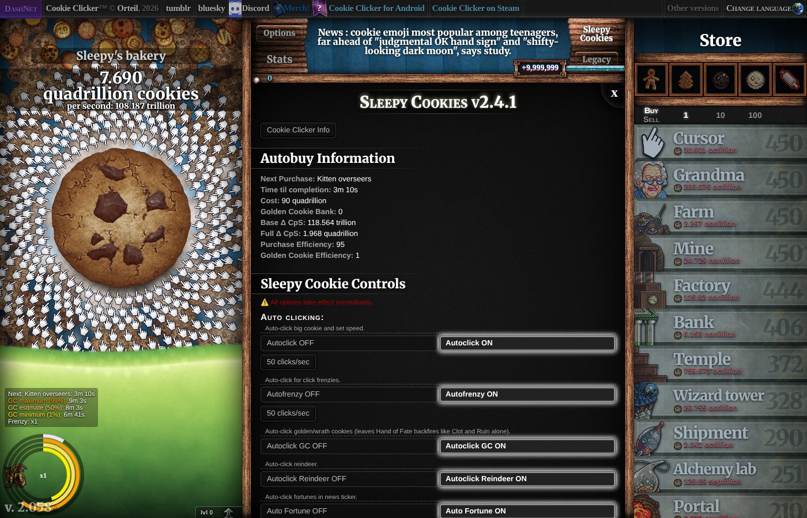

# Sleepy Cookies

Automation add-on for the web version of [Cookie Clicker](https://orteil.dashnet.org/cookieclicker/), built and tested on **v2.058**.

Sleepy Cookies is a rebuild of [Frozen Cookies](https://github.com/erbkaiser/FrozenCookies) for the current game, with its bugs fixed. It adds:
- **Smart Grimoire:** predicts upcoming spells and decides when to cast.
- **Auto Pantheon:** picks the best gods for you.
- **Stock market trader**
- **Garden planter**

It has no dependencies: it's a single file.

| Combo in progress (Frenzy + Click Frenzy + Building Special) | The Sleepy Cookies menu |
| --- | --- |
|  |  |

> **Heads-up:** Sleepy Cookies plays the game for you (buying, clicking, casting, trading, planting). Some players consider that cheating — use it if that's how you like to play.

## Install

There are three ways to load it; pick one.

### 1. Userscript (web version, loads automatically)

1. Install a userscript manager: [Tampermonkey](https://www.tampermonkey.net/) or [Violentmonkey](https://violentmonkey.github.io/).
2. Open **[sleepy-cookies.user.js](https://sleeeeeeeeeeeeeep-cmyl.github.io/sleepy-cookies/sleepy-cookies.user.js)** and click **Install**.
3. Open Cookie Clicker. Sleepy Cookies loads by itself every time, and the userscript manager keeps it up to date.

### 2. Steam version

1. Download **[SleepyCookies-steam.zip](https://sleeeeeeeeeeeeeep-cmyl.github.io/sleepy-cookies/SleepyCookies-steam.zip)**.
2. In Steam, right-click Cookie Clicker → **Manage → Browse local files**, then open `resources\app\mods\local`.
3. Unzip the download there, so you end up with `mods\local\SleepyCookies\info.txt` (plus `main.js` and `thumbnail.png`).
4. Start the game, open **Options**, turn on **Sleepy Cookies** in the mod list, and restart if the game asks.

The mod folder loads the latest version from this repository every time, so you get updates without reinstalling. Steam achievements are turned off while it's enabled, because it automates the game.

### 3. Console or bookmark (web version, one-off)

Open Cookie Clicker, press **F12 → Console**, paste this and press Enter:

```js
Game.LoadMod('https://sleeeeeeeeeeeeeep-cmyl.github.io/sleepy-cookies/sleepy_cookies.js');
```

Or save this as a bookmark and click it while the game is open:

```
javascript:(function(){Game.LoadMod('https://sleeeeeeeeeeeeeep-cmyl.github.io/sleepy-cookies/sleepy_cookies.js');})();
```

To open the settings, click the **Sleepy Cookies** button at the top of the middle panel, where the game's Info button was. Info has moved inside the Sleepy Cookies menu.

Your settings are saved in your browser, so they're still there next time you load the add-on.

To try it out quickly, scroll to the bottom of the menu and click **Apply recommended settings**.

## What it does

### Clicking
- Clicks the big cookie up to 50 times a second, and can click faster during click frenzies. 50 is the game's limit for scripted clicks.
- Clicks golden cookies, wrath cookies and reindeer.
  - Golden cookies created by Force the Hand of Fate carry a known effect. A Clot or Ruin from a backfire is left to fade instead of being clicked.
- Clicks fortunes in the news ticker.

### Buying
- Buys whichever building or upgrade gives the most CpS for its price, using Frozen Cookies' efficiency formula. That formula also counts golden cookies, clicking, wrinklers and reindeer.
- Works out what's needed to unlock an upgrade (buildings, other upgrades, Santa levels) and buys towards it.
- **Cookie bank:** saves a bank of cookies so Lucky golden cookies pay out in full. You can also set:
  - a manual minimum bank
  - a Spontaneous Edifice bank
  - a garden harvest bank
- **Blacklists:** Speedrun, Hardcore, Grandmapocalypse and No buildings.
- **Building limits:** caps on mines, factories, wizard towers and Yous.
- Buys useful upgrades the formula can't value, such as eggs, dragon drops and Green yeast digestives.
- Buys Santa levels and reward cookies, switches seasons to collect seasonal upgrades, and can stay in a free season.

### Other automation
- **Wrinklers:** pops them efficiently (only when it speeds up the next purchase) or instantly. Shiny wrinklers can be protected.
- **Sugar lumps:**
  - harvests ripe lumps
  - can slot Rigidel to harvest early
  - can swap in Dragon's Curve / Reality Bending at harvest time
  - can keep 100 lumps for Sugar baking
- **Auto-ascend:** ascends at a set number of heavenly chips, or when your prestige would double. Before ascending it cashes in:
  - wrinklers
  - stocks
  - the garden
  - the Chocolate egg, opened in time to count towards your chips
- **Golden switch, Godzamok and Sugar Frenzy:** during click buffs, turns on the Golden switch and sells and rebuys mines and factories for Godzamok, but only when the extra clicking is worth more than the cost. A Golden switch you turned on yourself is left alone. It also buys Sugar Frenzy (once per ascension) the first time your CpS multiplier reaches your set level, paying its sugar lump like normal.
- **Stock market:** upgrades your bank office, hires brokers, and takes loans during huge combos.

### Smart Grimoire
The game decides each Force the Hand of Fate result in advance, so Sleepy Cookies reads the next ones and plans each cast:
- **Free sugar lump next:** cast immediately.
- **Good result next** (Click Frenzy, Elder Frenzy, Building Special, Cursed Finger or Lucky):
  - Cast the moment your CpS multiplier reaches your **minimum Frenzy** setting (default ×7, so any Frenzy works).
  - Only needs enough mana for the spell, not a full bar.
  - Won't stack a second Click Frenzy on top of one already running.
- **Two good results in a row with full mana:** double-cast. It sells wizard towers so the second cast is cheap, re-checks the prediction, then buys the towers back.
- **Bad result next** (Clot, Ruin, Blab, Cookie Storm drop): spent on a cheap spell so the next cast is a good one. During a Clot it uses Stretch Time when that spell is predicted to backfire, because a backfire shortens the Clot.
- **Combo chaining**, while a boost stack is running:
  - **Bad result with a good one behind it:** if there's mana for both, it skips the bad one right away and casts the good one a second later. When Stretch Time is predicted to succeed, it uses that for the skip, which also makes every running buff 10% longer.
  - **Click buff on top of a Frenzy:** uses Stretch Time to lengthen the whole stack, but only when it will succeed and enough mana is left for the next Force the Hand of Fate.
- **Spell tooltip:** hover over Force the Hand of Fate to see the next four results.

### Auto Pantheon
Tests every combination of the useful gods with the efficiency formula and slots the best one. That includes leaving slots empty when a god would cost more than it gives.
- It only uses a worship swap when the gain is over 1%.
- Godzamok stays in the diamond slot when Auto-Godzamok is on.
- Rigidel is left to the sugar lump option.

### Dragon
Upgrades and pets the dragon (for its drops), sets your two chosen auras, and can sell Yous for Dragon Orbs. The dragon popup only stays open if you opened it yourself.

### Stock market trader (Sleepy extra)
- **Simulation:** every market tick (once a minute), it simulates 120 possible next 4 hours for each stock using the game's own price rules. By default it also uses each stock's hidden trend and mode.
- **Buying:** buys when the expected profit after the broker fee is at least your minimum (15% by default).
- **Selling:** sells when the current price beats what holding on is expected to bring.
- **Budget:**
  - It never touches the cookie bank.
  - It uses cookies auto-buy is saving up only when a stock is expected to grow faster than the next purchase would pay back. That's usually late game, when purchases take days to pay off.
  - Stock prices are measured in seconds of your highest CpS, so shares keep their value as your CpS grows.

### Garden planter (Sleepy extra)
- **Unlock new seeds:**
  - **Target:** picks the locked seed that should unlock soonest, counting the time to grow the parents, the wait for the mutation and the time for the new plant to grow.
  - **Odds:** works out the exact chance of each mutation from the game's own rules, including that a 20% Baker's wheat spread competes with a 5% Thumbcorn for the same tile.
  - **Layout:** improves the planting layout tile by tile. For Thumbcorn on a full plot that means 26 mutation slots instead of 8.
  - **Spores:** for Brown mold and Crumbspore it plants Meddleweed and pulls it just before it would die of old age. Spores drop more often the older the weed is.
  - **Harvest:** harvests each new plant when it's mature, which unlocks its seed.
- **Farm one seed:** **Auto** picks the seed and soil worth the most cookies per second right now.
  - It tests each option by filling the plot with that plant in a simulation and recomputing your CpS, including golden cookie, milk and clicking effects.
  - It also uses the game's harvest payouts, for example Bakeberry pays 3% of your bank, up to 30 minutes of CpS.
  - It harvests payout plants (Bakeberry, Chocoroot, Queenbeet, Duketater) when they're mature and leaves passive ones like Baker's wheat to live out their life.
- **Soil:** switches automatically. In unlock mode it grows parents on Fertilizer, switches to Wood chips (3× mutations) once they're mature, and goes back to Fertilizer while a new plant grows. In farm mode it uses whichever soil pays best.
- Clears weeds and unwanted mutations.

### Info and display
- An info section with everything Frozen Cookies shows: next purchase, bank, golden cookie timers, heavenly chip rate, frenzy times and stat graphs.
- An optional timer wheel.
- Five number formats.
- Adjustable frame rate.

## Keyboard shortcuts
These are off while you're typing in a text box.

| Key | Action |
| --- | --- |
| `a` | Auto-buy on/off |
| `b` | Copy your building counts |
| `c` | Auto-click golden cookies on/off |
| `e` | Export your save |
| `r` | Open the Ascend prompt |
| `s` | Save the game |
| `w` | Show the wrinkler payout, with a button to pop them all |

## Console commands

| Command | What it does |
| --- | --- |
| `SleepyCookies.stop()` | Unload the add-on and restore the game |
| `SleepyCookies.resetSettings()` | Reset all settings to defaults (paste the load line again afterwards) |
| `SleepyCookies.nextPurchase()` | What auto-buy will get next |
| `SleepyCookies.nextSpell(0)` | Next Force the Hand of Fate result (`1` = the one after, and so on) |
| `SleepyCookies.version` | Loaded version |

## Troubleshooting
- **Nothing happens / `undefined`:** `Game.LoadMod` always prints `undefined`. Look for the **Sleepy Cookies** button instead. If it isn't there, check the file name in the link: it's `sleepy_cookies.js`, with an underscore.
- **Still on the old version after an update:**
  - GitHub Pages can take a few minutes to serve the new file.
  - Refresh the game with **Ctrl+F5** and load it again.
  - The version is shown in the menu header.
- **Steam version:** use the Steam mod folder (install option 2). The console line and bookmark only work in the web version.

## Credits and license

Based on [Frozen Cookies](https://github.com/Icehawk78/FrozenCookies) by Icehawk78, erbkaiser and contributors.

Frozen Cookies is released under **GPL-3.0-or-later**, so Sleepy Cookies is too: you may use, change and share it, but anything you distribute that's based on it has to stay under the same license, with its source available. See [LICENSE](LICENSE).

Bug reports and ideas are welcome in [Issues](https://github.com/sleeeeeeeeeeeeeep-cmyl/sleepy-cookies/issues).
